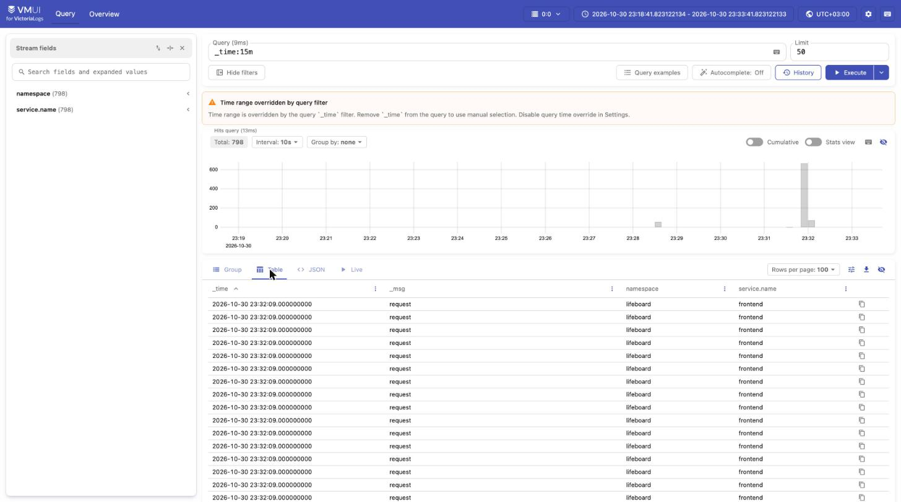
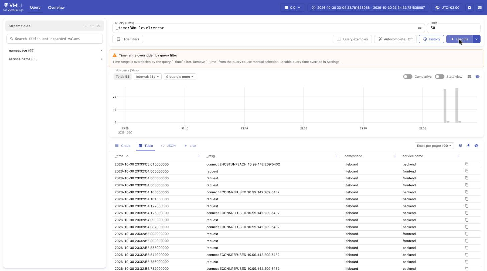
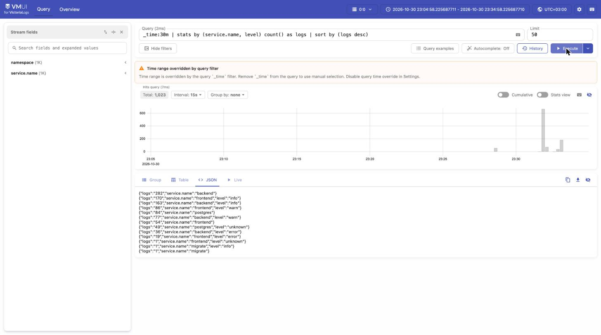
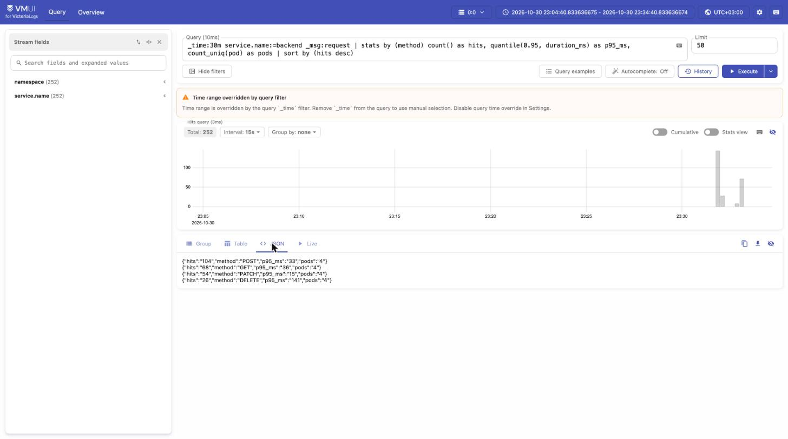

# Отчёт по ДЗ №3. Логирование

## Что сделано

**Victoria Logs** запущена single-node в namespace `monitoring`: StatefulSet, том на 1 ГБ и Service на порту 9428. Манифест написал сам, он лежит в `k8s/logging/victoria-logs.yaml`. Helm здесь не нужен: под всего один и настроек почти нет.

**Логи приложения** теперь в JSON с полями из чек-листа семинара: `timestamp` в ISO 8601, `level`, `message`, `service.name`. Бэкенд добавляет `method`, `path`, `status` и `duration_ms`. Уровень зависит от ответа: 5xx это `error`, 4xx это `warn`, остальное `info`. У nginx тоже настроен JSON access-лог с теми же полями, а запросы проб kubelet в него не попадают.

**Доставка** сделана через Vector, он запущен DaemonSet'ом. Конфиг лежит в `k8s/logging/vector.yaml`.

Запись выглядит примерно так:

```json
{"timestamp":"2026-10-30T20:31:54.460Z","level":"error","message":"request","service.name":"backend","method":"GET","path":"/api/spaces","status":500,"duration_ms":3}
```

## Почему Vector и DaemonSet

Взял агент на ноде. Он один на всю ноду и читает логи всех контейнеров, а приложение про него не знает и просто пишет в stdout. Сайдкар пришлось бы добавлять в каждый под. Отправлять логи прямо из кода я не хотел, это привязало бы приложение к конкретной системе логов.

Vector удобен тем, что источник `kubernetes_logs` сам подтягивает метаданные пода, а на VRL легко развернуть JSON в поля. Читаю только namespace `lifeboard`. Если строка не JSON, например вывод Postgres, она сохраняется как есть с `level=unknown`, а `service.name` берётся из метки пода.

В Victoria Logs записи идут через её Elasticsearch-совместимый эндпоинт. Стримы разбиты по `namespace` и `service.name`: значений там мало, а `pod` и `path` в стрим выносить нельзя, стримов стало бы слишком много.

## Запуск

```bash
./scripts/build-images.sh
kubectl -n lifeboard delete job migrate --ignore-not-found
kubectl apply -k k8s/
kubectl apply -k k8s/logging/
kubectl -n monitoring port-forward svc/victoria-logs 9428:9428
```

Интерфейс открывается на http://localhost:9428/select/vmui/. Job приходится удалять заранее, потому что шаблон Job нельзя менять, а в манифесте поменялся тег образа. Трафик для примеров дал скрипт `scripts/traffic.sh`: обычный CRUD и немного ошибочных запросов.

## Запросы LogsQL

**(а) Сырые записи за 15 минут**

```
_time:15m
```

Показывает всё, что пришло за это время. На графике видны всплески от `traffic.sh`.



**(б) Фильтр по полю**

```
_time:30m level:error
```

Только ошибки. С такого запроса обычно начинают разбираться со сбоем. На скриншоте видны оба сбоя базы: бэкенд пишет `ECONNREFUSED`, а фронтенд отвечает 502.



**(в) Stats с группировкой**

```
_time:30m | stats by (service.name, level) count() as logs | sort by (logs desc)
```

Сколько записей дал каждый сервис на каждом уровне. По этой таблице я и заметил проблему, про которую написано ниже: у бэкенда оказалось 282 записи без уровня. Сейчас такие записи получают `level=unknown`, а строки без уровня на скриншоте появились до этой правки.



**(г) Агрегация**

```
_time:30m service.name:=backend _msg:request
| stats by (method) count() as hits, quantile(0.95, duration_ms) as p95_ms, count_uniq(pod) as pods
| sort by (hits desc)
```

Число запросов, p95 времени ответа и число подов по каждому HTTP-методу. Видно, что запросы разошлись по нескольким подам. Значение `pods` равно 4, потому что за полчаса поды пересоздавались.



## Что нашёл по логам

**Бэкенд падал при рестарте базы.** Чтобы получить записи уровня `error`, я ненадолго погасил Postgres, а в логах появился стек с `Unhandled 'error' event`. У пула `pg` не было обработчика ошибок, и обрыв простаивающего соединения ронял весь процесс. Похоже, отсюда же были и рестарты подов бэкенда в ДЗ №2. Добавил `pool.on('error', ...)` в `backend/src/db.js` и повторил сбой: бэкенд отвечает 500, пока базы нет, рестартов ноль, а после возврата базы всё работает.

## На что наткнулся

**Под Victoria Logs завис в Pending.** PVC не создавался, потому что в `kube-system` пропал под `storage-provisioner`, хотя аддон значился включённым. Помогло `minikube addons enable storage-provisioner`.

**Первые записи Vector с ошибками.** Vector стартовал раньше базы логов и какое-то время писал `Connection refused`. Это нормально: он повторяет отправку и теряет данные только при переполнении буфера.

Бонус с Grafana и vmalert я не делал.
