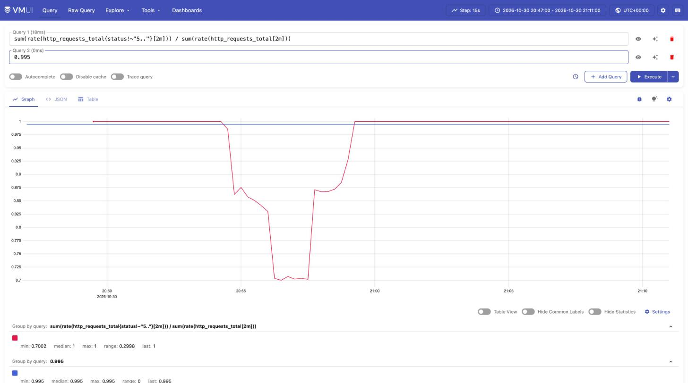
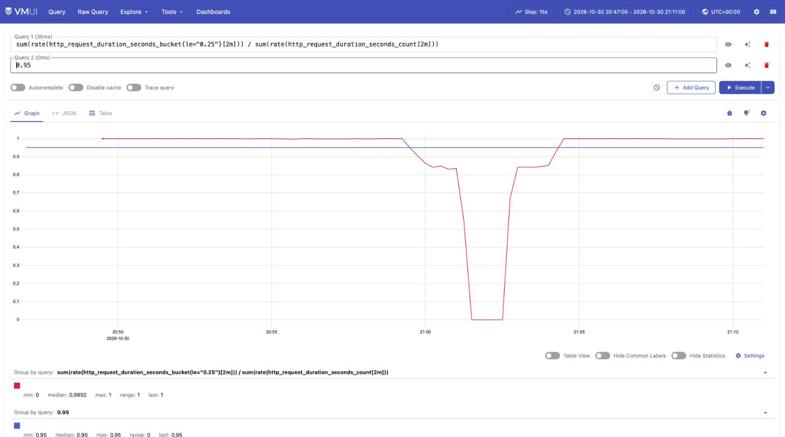
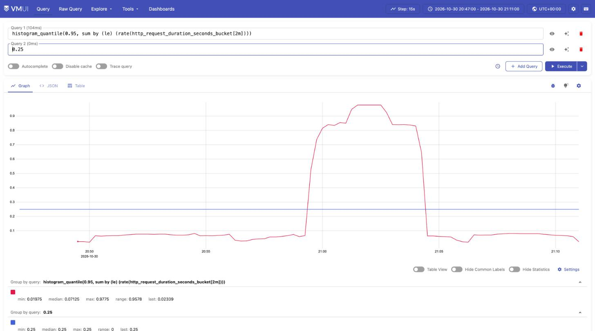
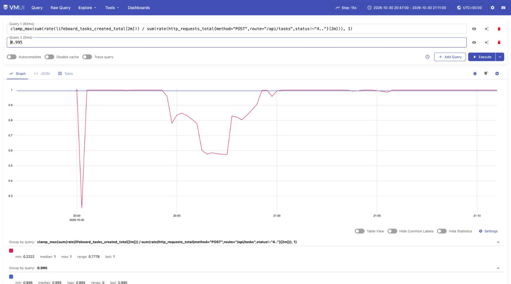
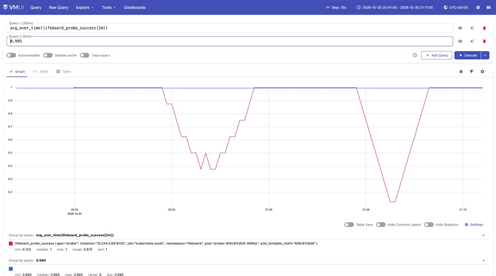
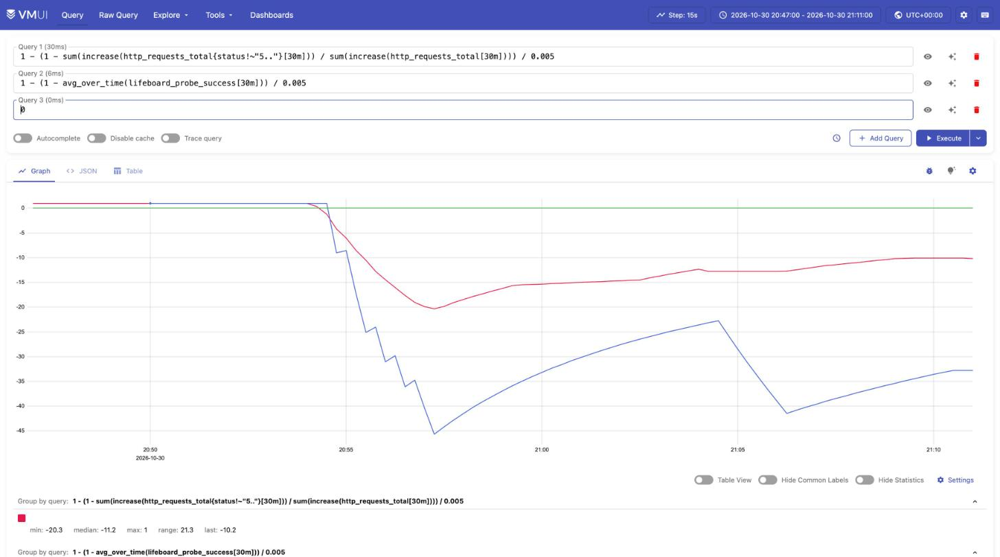

# Отчёт по ДЗ №5. SLA

## Выбранные метрики

| SLI | Метрика | Тип | Что показывает |
|---|---|---|---|
| Доступность API | `http_requests_total` из ДЗ №4 | RBSLO | Доля запросов без ответа 5xx |
| Скорость | `http_request_duration_seconds` из ДЗ №4 | RBSLO | Доля запросов быстрее 250 мс |
| Создание таски | `lifeboard_tasks_created_total` из ДЗ №4 | RBSLO | Доля попыток создать таску, которые закончились успехом |
| Пробер | `lifeboard_probe_success`, новая | TBSLO | Доля времени, когда пользовательский сценарий работает |

Первые три считаются по метрикам самого приложения, пробер ходит снаружи. В прогоне пригодилось и то, и другое.

`pg_up` я брать не стал, хотя сначала собирался. Экспортер живёт в одном поде с базой, поэтому при падении пода метрика просто исчезает и вместо нуля получается дыра в графике.

## Пробер

Это отдельный Deployment `prober` из того же образа, код лежит в `backend/src/prober.js`. Каждые 15 секунд он идёт в Service `frontend`, то есть через тот же nginx, что и браузер, и проходит сценарий: создаёт раздел, создаёт таску, читает её и удаляет раздел. Если любой шаг вернул ошибку или не уложился в 5 секунд, проба считается неудачной. Раздел удаляется и после неудачи, чтобы проба не копила мусор.

Пробы попадают в метрики приложения, поэтому у `lifeboard_tasks_created_total` появился приоритет `zero`. Для настоящей статистики продукта его нужно исключать.

## Формулы и цели

Окно SLO везде 30 дней. Для коротких графиков я брал окно 2 минуты, в запросах ниже оно обозначено как `[W]`.

**Доступность API. SLO: 99,5%.**

```
sum(rate(http_requests_total{status!~"5.."}[W])) / sum(rate(http_requests_total[W]))
```

**Скорость. SLO: 95% запросов быстрее 250 мс.**

```
sum(rate(http_request_duration_seconds_bucket{le="0.25"}[W])) / sum(rate(http_request_duration_seconds_count[W]))
```

**Создание таски. SLO: 99,5%.** Ошибки клиента из знаменателя убраны: если человек прислал неверные данные, сервис не виноват.

```
clamp_max(
  sum(rate(lifeboard_tasks_created_total[W]))
  / sum(rate(http_requests_total{method="POST",route="/api/tasks",status!~"4.."}[W])),
  1)
```

`clamp_max` нужен потому, что две разные метрики иногда дают отношение чуть выше единицы, в прогоне встречалось 1.07.

**Пробер. SLO: 99,5% времени.**

```
avg_over_time(lifeboard_probe_success[W])
```

**Бюджет ошибок.** При SLO 99,5% на 30 дней допустимо 0,5% времени, то есть 216 минут простоя в месяц. Остаток бюджета считается так, 1 означает полный бюджет, 0 значит, что он исчерпан:

```
остаток = 1 - (1 - SLI) / (1 - SLO)
```

## SLA

**Life Board доступен 99% времени в календарный месяц.** Это 432 минуты простоя в месяц. Измеряем по проберу: сервис считается доступным, если пользователь может создать таску и прочитать её.

Сейчас продукт ставится на свой сервер, так что внешнего договора нет. Если появится размещённая версия, при нарушении SLA логично вернуть 10% оплаты за месяц.

SLA специально мягче внутреннего SLO. Между ними остаётся запас, чтобы успеть отреагировать до нарушения обещания. Подтвердить эти цифры месячной статистикой пока нельзя, стенд работает недолго, поэтому это цели. SLA не может быть выше фактически подтверждённого SLO.

## Как менялось поведение приложения

Для демонстрации в бэкенд добавлен управляемый сбой, он включается переменными окружения и по умолчанию выключен. На пробы `/livez` и `/readyz` он не действует, иначе Kubernetes начал бы перезапускать поды.

```bash
./scripts/fault.sh errors   # FAULT_ERROR_RATE=0.3: 30% запросов к API отвечают 500
./scripts/fault.sh slow     # FAULT_DELAY_MS=600: каждый запрос медленнее на 600 мс
./scripts/fault.sh db       # postgres масштабируется в 0
./scripts/fault.sh off      # всё вернуть
```

Прогон занял 19 минут при постоянном трафике от `scripts/traffic.sh`. Значения ниже сняты в конце каждого участка, с окном 2 минуты:

| Участок | Доступность | Быстрые | Создание таски | Пробер | p95, с |
|---|---|---|---|---|---|
| Норма | 1,000 | 1,000 | 1,000 | 1,000 | 0,07 |
| 30% ошибок | 0,707 | 0,999 | 0,587 | 0,375 | 0,03 |
| Замедление | 1,000 | 0,000 | 1,000 | 1,000 | 0,98 |
| База упала | 1,000 | 1,000 | 1,000 | 0,250 | 0,04 |
| Восстановление | 1,000 | 0,999 | 1,000 | 1,000 | 0,08 |

За весь прогон было 6802 запроса, из них 393 с ответом 5xx, и 76 проб, из них 15 неудачных.

## Графики

Синяя линия на графиках это цель. Участки идут так: ошибки с 20:54 до 20:57, замедление с 20:59 до 21:02, падение базы с 21:04 до 21:06 (время UTC).

**Доступность API.** На участке с ошибками значение падает до 0,70, то есть ровно на те 30%, что я включил.



**Скорость.** Ошибки на неё не влияют, зато при замедлении она падает до нуля: все запросы медленнее 250 мс.



**p95 времени ответа.** Показывает то же замедление в секундах, синяя линия стоит на 250 мс.



**Создание таски.** Проседает сильнее общей доступности, 0,58 против 0,70. Это особенность моего трафика: `traffic.sh` намеренно шлёт неверные POST. Обычно они дают 400 и из расчёта исключаются, а под сбоем отвечают 500 и попадают в знаменатель. Провал до 0,22 в 20:50 это артефакт старта: у новых подов счётчик только появился, и `rate` не увидел его первый прирост. Настоящего сбоя в этот момент не было, пробер его не показал.



**Пробер.** Единственный график, который заметил падение базы. На участке с ошибками значение около 0,4: в сценарии четыре запроса, и достаточно одного неудачного, чтобы провалить всю пробу.



**Остаток бюджета.** Здесь окно 30 минут вместо 30 дней, поэтому значения уходят далеко в минус: за полчаса сбоев бюджет короткого окна сгорает быстро. Красная линия это запросы, синяя это пробер. Видно, что бюджет съедают ошибки и база, а замедление на него не влияет: у скорости свой бюджет.



## Что нашлось

**Метрики приложения не видят падение базы.** Этого я не ожидал. В первые секунды бэкенд ещё отвечает 500, но затем readiness перестаёт проходить, Service остаётся без подов, и nginx сам отвечает 502. Запросы не доходят до бэкенда, поэтому метрик об ошибках нет, а график доступности стоит на единице. Заметил проблему только пробер: `create space: HTTP 502`. Поэтому SLA я меряю по проберу, иначе по метрикам вышло бы, что при упавшей базе всё работало.

**Замедление не считается недоступностью.** При задержке 600 мс пробер остаётся зелёным, потому что у него таймаут 5 секунд. Поэтому у скорости нужен отдельный SLI.

Grafana я не подключал, она необязательна: графики построены во встроенном vmui.
