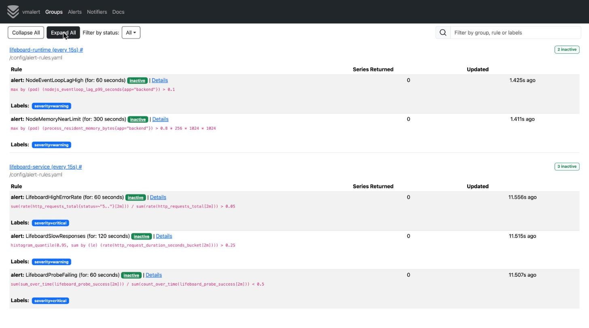
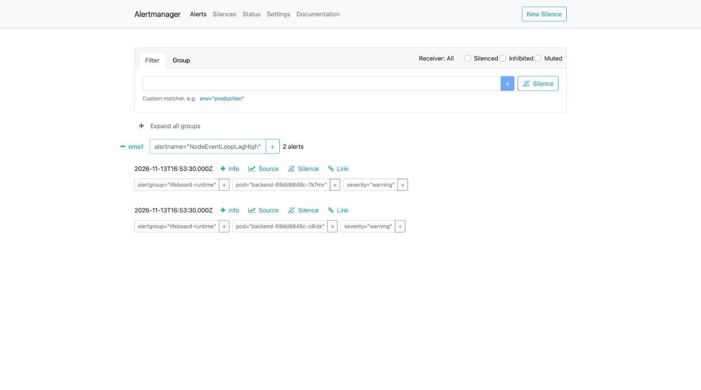
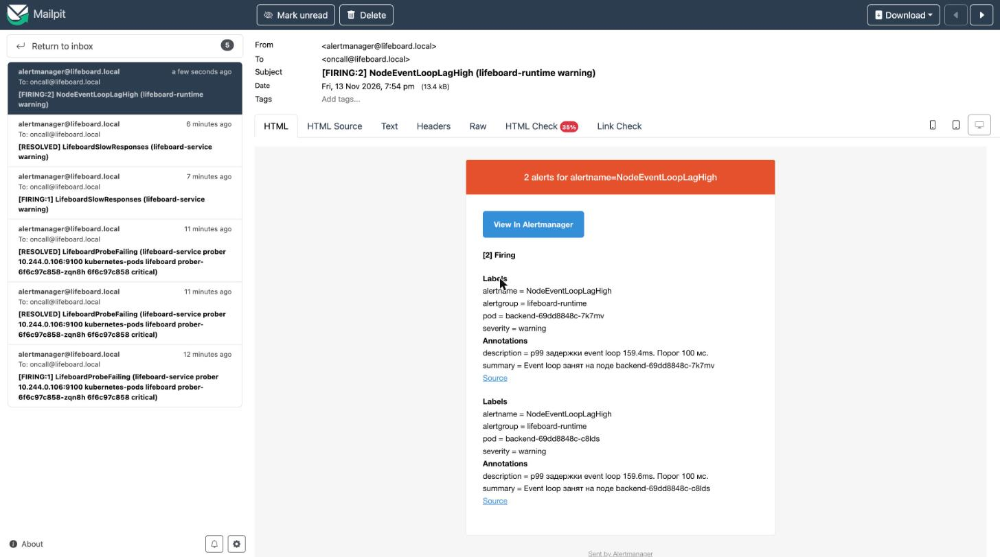
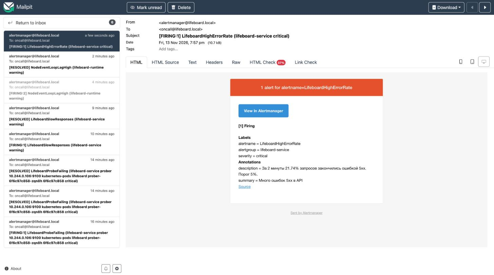

# Отчёт по ДЗ №6. Алерты

## Что хотелось ловить

Отталкивался от SLO из прошлой домашки: доля ошибок, скорость ответа и пробер. На каждое сделал по алерту. Ещё два алерта смотрят на сам процесс Node.js, они должны сработать раньше, чем проблему заметит пользователь.

## Алерты на метрики сервиса

**LifeboardHighErrorRate, critical.** Доля ответов 5xx за 2 минуты выше 5%, условие держится минуту.

```
sum(rate(http_requests_total{status=~"5.."}[2m])) / sum(rate(http_requests_total[2m])) > 0.05
```

SLO по доступности 99,5%, то есть бюджет 0,5% ошибок. При 5% бюджет расходуется в десять раз быстрее нормы. Минута `for` нужна, чтобы алерт не срабатывал от одного перезапуска пода.

**LifeboardSlowResponses, warning.** p95 времени ответа выше 250 мс в течение 2 минут.

```
histogram_quantile(0.95, sum by (le) (rate(http_request_duration_seconds_bucket[2m]))) > 0.25
```

Порог тот же, что в SLO по скорости. Это warning: сервис работает, просто медленно, и разбираться можно в рабочее время.

**LifeboardProbeFailing, critical.** За 2 минуты прошло меньше половины проб.

```
sum(sum_over_time(lifeboard_probe_success[2m])) / sum(count_over_time(lifeboard_probe_success[2m])) < 0.5
```

Этот алерт закрывает дыру, которую я нашёл в ДЗ №5: когда падает база, запросы не доходят до бэкенда, и его метрики показывают, что всё хорошо. Пробер ходит снаружи и такой сбой видит.

## Алерты на метрики рантайма

У меня Node.js, актуатора нет. Метрики рантайма отдаёт библиотека `prom-client`, я подключил её в ДЗ №4.

**NodeEventLoopLagHigh, warning.** p99 задержки event loop на поде выше 100 мс в течение минуты.

```
max by (pod) (nodejs_eventloop_lag_p99_seconds{app="backend"}) > 0.1
```

В Node.js один поток. Если его занять синхронной работой, ждут все запросы этого пода. В спокойном состоянии метрика держится около 20 мс, так что 100 мс это уже явная проблема. Алерт считается по каждому поду отдельно, чтобы было видно, какой именно тормозит.

**NodeMemoryNearLimit, warning.** RSS процесса выше 80% лимита контейнера (256 МиБ) в течение 5 минут.

```
max by (pod) (process_resident_memory_bytes{app="backend"}) > 0.8 * 256 * 1024 * 1024
```

Если память дойдёт до лимита, Kubernetes убьёт контейнер. Алерт даёт время посмотреть на утечку до этого. Сейчас бэкенд занимает около 100 МиБ, так что в работе я этот алерт не видел.

## Alertmanager

- Письма уходят на `oncall@lifeboard.local` через Mailpit. Это почтовый ящик с веб-интерфейсом внутри кластера, манифест в `k8s/alerting/mailpit.yaml`. Наружу со стенда ничего не отправляется.
- Алерты группируются по имени: если тормозят оба пода, приходит одно письмо с двумя алертами.
- Первое письмо уходит через 15 секунд после срабатывания, повтор через 4 часа, для critical через час.
- `send_resolved` включён, после восстановления приходит письмо RESOLVED.
- Есть одно правило подавления: пока горит `LifeboardProbeFailing`, предупреждения уровня warning не рассылаются. Когда сервис лежит целиком, письма про скорость только мешают.

## Как срабатывало

Для проверки я добавил в `scripts/fault.sh` режим `block`: каждый запрос 150 мс крутит пустой цикл и занимает event loop.

**Список правил в vmalert.**



**Алерт рантайма.** В 19:52 включил `./scripts/fault.sh block`, задержка event loop выросла до 160 мс. В 19:54 пришло письмо с двумя алертами, по одному на под.





**Алерт сервиса.** В 19:54 переключил на `./scripts/fault.sh errors` (30% ответов 500). В 19:57 пришло письмо: 21,74% запросов с ошибкой при пороге 5%.



**Незапланированная проверка.** Первые письма в ящике на скриншотах я не вызывал. Во время работы ноде minikube не хватило памяти, поды начали перезапускаться, и в 19:42 сам сработал `LifeboardProbeFailing`, а следом `LifeboardSlowResponses`.

## Запуск

vmalert и Alertmanager ставятся одним чартом `vm/victoria-metrics-alert` в namespace `monitoring`. Конфигурация лежит в `k8s/alerting/values.yaml`: правила в `server.config.alerts`, настройки Alertmanager в `alertmanager.config`.

```bash
kubectl apply -k k8s/alerting/
helm upgrade --install vm-alert vm/victoria-metrics-alert --version 0.52.0 -n monitoring -f k8s/alerting/values.yaml
kubectl -n monitoring port-forward svc/vm-alert-victoria-metrics-alert-server 8880:8880
kubectl -n monitoring port-forward svc/mailpit 8025:8025
```

Правила видны на http://localhost:8880/vmalert/groups, письма на http://localhost:8025.
