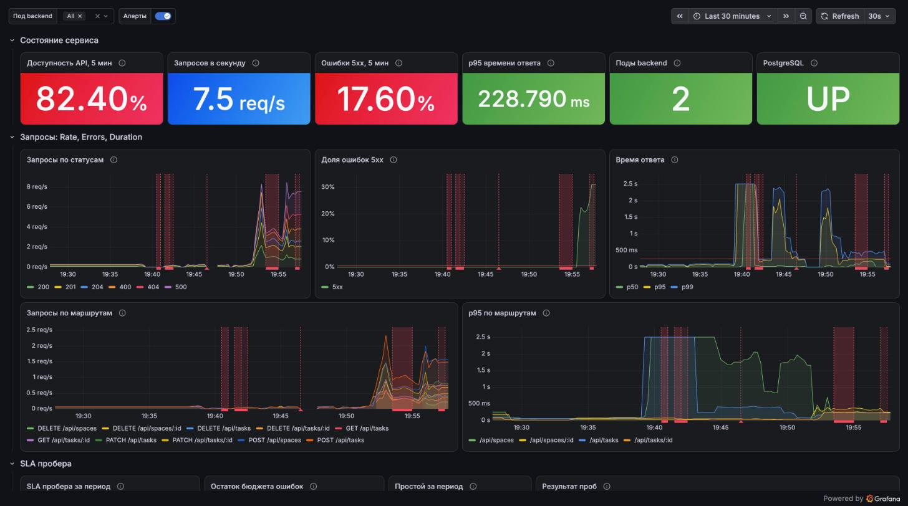
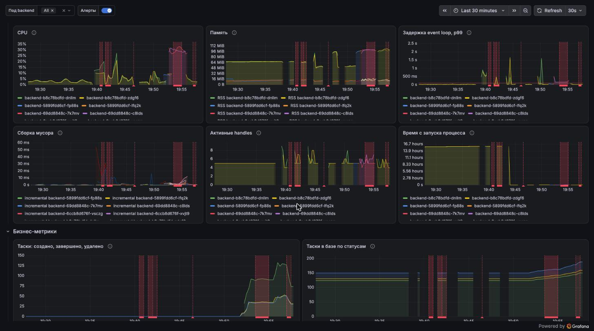
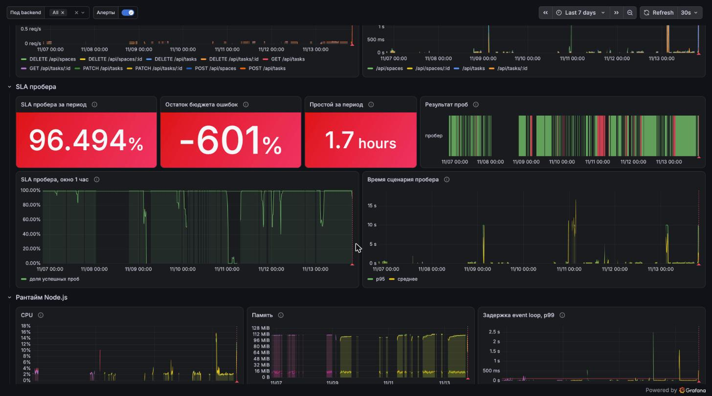
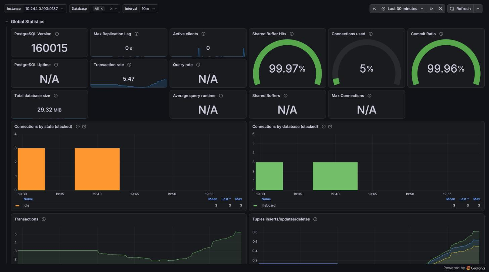

# Отчёт по ДЗ №7. Grafana

## Установка

```bash
helm repo add grafana-community https://grafana-community.github.io/helm-charts
helm repo update
kubectl apply -k k8s/grafana/
helm upgrade --install grafana grafana-community/grafana --version 14.4.1 -n monitoring -f k8s/grafana/values.yaml
kubectl -n monitoring port-forward svc/grafana 3000:80
```

Настройки лежат в `k8s/grafana/values.yaml`. Источник данных и дашборд приложения описаны там же, поэтому после установки ничего не нужно настраивать руками. JSON дашборда лежит в `k8s/grafana/lifeboard-dashboard.json` и попадает в Grafana через ConfigMap, то есть дашборд хранится в git вместе с кодом.

Смотреть дашборды можно без входа, анонимный пользователь получает роль Viewer. Для стенда это удобно, в настоящем окружении я бы так не делал. Пароль пользователя admin лежит в секрете `grafana`.

## Источник данных

Один источник: Victoria Metrics из ДЗ №4. В Grafana он заведён как Prometheus, потому что Victoria Metrics отвечает на те же запросы. Адрес внутри кластера `http://vm-single-victoria-metrics-single-server:8428`. Логи из Victoria Logs я не подключал, для них нужен отдельный плагин.

## Дашборд приложения

Дашборд читается сверху вниз: сначала видно, жив ли сервис, потом идут детали. Экспортированный JSON приложен: `k8s/grafana/lifeboard-dashboard.json`.

**Состояние сервиса.** Шесть крупных плиток: доступность API, запросы в секунду, доля ошибок 5xx, p95 времени ответа, число подов бэкенда и состояние Postgres. Цвета привязаны к SLO из ДЗ №5: доступность краснеет ниже 99%, p95 желтеет после 250 мс. По этой строке сразу видно, есть ли проблема.

**Запросы.** Здесь подход RED. Rate: запросы по статусам и по маршрутам. Errors: доля 5xx с линией бюджета 0,5%. Duration: p50, p95 и p99, отдельно p95 по маршрутам, чтобы найти медленный.

**SLA пробера.** Про эту строку ниже.

**Рантайм Node.js.** Тут ближе к USE. Загрузка: CPU и память с линией лимита контейнера. Насыщение: задержка event loop. Ещё сборка мусора, активные handles и время с запуска процесса, по нему видны перезапуски. Переменная «Под backend» вверху фильтрует эту строку по подам.

**Бизнес-метрики.** Сколько тасок создают, завершают и удаляют в минуту и сколько их лежит в базе по статусам. Таски пробера с приоритетом `zero` из графика исключены.

Красные отметки на графиках это аннотации: моменты, когда горели алерты из ДЗ №6. Они берутся из ряда `ALERTS`, который vmalert пишет в Victoria Metrics.

На первом скриншоте включён сбой `./scripts/fault.sh errors`, 30% запросов отвечают 500. Плитки доступности и ошибок покраснели, на графиках видны оба сбоя и отметки алертов.





## Панель SLA пробера

SLA считается за период, выбранный на дашборде. На скриншоте это 7 дней.

```
sum(sum_over_time(lifeboard_probe_success[$__range])) / sum(count_over_time(lifeboard_probe_success[$__range]))
```

Рядом три связанные панели. Остаток бюджета ошибок при SLO 99,5% считается по формуле из ДЗ №5. Простой это число неудачных проб, умноженное на интервал сбора 15 секунд. Лента «Результат проб» показывает, когда именно были сбои.



За 7 дней получилось 96,49% и 1,7 часа простоя. Это ниже SLA 99% из ДЗ №5. Стенд работает на ноутбуке: когда он засыпает и просыпается, поды перезапускаются, и пробы в это время не проходят. Сюда же попали мои проверки алертов. Заявлять SLA 99% без накопленной статистики было рано.

## Дашборд PostgreSQL Exporter

Взял дашборд с ID 12485 с grafana.com, скачал JSON и импортировал его в Grafana. Он лежит в `k8s/grafana/postgres-exporter-12485.json`.



Сразу после импорта он был пустой. Пришлось поправить три вещи:

- Переменная Instance искала ряды с меткой `job="postgres-exporter"`. У меня метрики собираются через service discovery, и `job` равен `kubernetes-pods`. Заменил запрос на `label_values(pg_up, instance)`.
- Размер базы в свежем экспортере называется `pg_database_size_bytes`, а в дашборде было `pg_database_size`.
- То же с отставанием репликации: `pg_replication_lag_seconds` вместо `pg_replication_lag`.

Несколько плиток остались с N/A. Query rate и Average query runtime требуют расширения `pg_stat_statements`, оно у меня не включено. Для Uptime экспортер не отдаёт нужную метрику.

## На что наткнулся

**Ноде не хватило памяти.** Grafana 13 занимает около 1 ГБ, а у minikube было 4 ГБ на всё. Поды начали перезапускаться с OOMKilled, заодно сработали алерты из ДЗ №6. Поднял память ноды до 6 ГБ, в `scripts/start-minikube.sh` теперь `--memory=6144`. Ещё поставил Grafana стратегию Recreate: при обычном обновлении стартовали два пода сразу, и оба не помещались.

**Пароль admin не подошёл после переустановки.** Том Grafana пережил удаление релиза, это та же особенность хранилища minikube, что и в ДЗ №2. В базе остался пароль от первой установки, а в секрете лежал новый. Помог сброс: `kubectl -n monitoring exec deploy/grafana -- grafana cli admin reset-admin-password <пароль из секрета>`.

**Панель SLA показывала два числа.** У пробера после перезапуска новый под, а значит новый временной ряд. `avg_over_time` считал SLA по каждому ряду отдельно. Теперь успешные и все пробы суммируются по всем рядам. Ту же ошибку поправил в алерте пробера.
